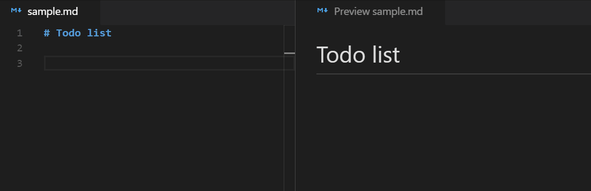
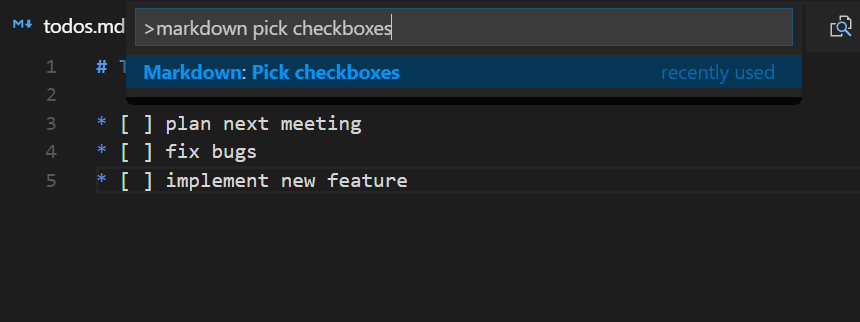

<h1 align="center">
  <br>
    
  <br><br>
  Markdown Checkbox
  <br>
  <br>
</h1>

<h4 align="center">Create and toggle checkboxes in Markdown documents</h4>

> **xQx fork.** Maintained by Will Lotto ([xQx](https://github.com/will-lottkowitz-prism)) and
> published to the VS Code Marketplace as `xQx.markdown-checkbox`. Forked from
> [PKief/vscode-extension-markdown-checkbox](https://github.com/PKief/vscode-extension-markdown-checkbox)
> (MIT); all prior work and credit remain with Philipp Kief. This fork exists to carry
> xQx-specific changes and stay independently installable.
>
> Issues and pull requests for this fork:
> <https://github.com/will-lottkowitz-prism/markdown-checkbox>

## Description

With this extension for Visual Studio Code it's possible to create todo lists in markdown. The extension provides shortcuts and some workspace configurations to create checkboxes and mark them with a shortcut.

## How to use



## Information in status bar


_At least one checkbox must exist in a file to see this information._ Clicking
the item opens the [Pick Checkboxes](#pick-checkboxes) QuickPick. Hide it with
`markdown-checkbox.showStatusBarItem: false`.

## Pick Checkboxes

Toggle all checkboxes in the current document with the Multi-Select QuickPick:



The QuickPick can be opened either from the command palette or by clicking on the status bar item.

## Smart paste (fork addition)

While `markdown-checkbox.dedupePasteMarkers` is enabled (default), pasting into a
Markdown file with the caret parked **directly after a bare list marker** strips a
duplicate leading marker from the pasted text, so markers don't stack up:

| Caret is after | Clipboard starts with | Pasted as |
| --- | --- | --- |
| `- ` | `- buy milk` | `- buy milk` (not `- - buy milk`) |
| `- [ ] ` | `- [ ] task` | `- [ ] task` (not `- [ ] - [ ] task`) |
| `- [ ] ` | `- [x] one`<br>`- [ ] two` | `- [ ] one`<br>`- [ ] two` (only the first marker is stripped) |
| `1. ` | `1. first` | `1. first` |

Every other paste is handed straight to VS Code's normal paste, so nothing else
changes. Disable the behavior by setting `markdown-checkbox.dedupePasteMarkers`
to `false`.

## Table cell navigation (fork addition)

While `markdown-checkbox.tableCellNavigation` is enabled (default), inside a
Markdown table:

| Key | Behavior |
| --- | --- |
| <kbd>Tab</kbd> | Move to the next cell (wrapping to the next row); on the last cell of the last row, append a new empty row |
| <kbd>Shift</kbd> + <kbd>Tab</kbd> | Move to the previous cell (wrapping to the previous row) |

Each move reformats the table - every column is padded to a common width and
column alignment is taken from the `:--` / `--:` / `:-:` delimiter row. Outside a
table, <kbd>Tab</kbd> / <kbd>Shift</kbd>+<kbd>Tab</kbd> keep their list-indent
behavior.

Two commands (also on the editor right-click menu) format without navigating:

- **Markdown: Format this table** (`markdown-checkbox.formatTable`)
- **Markdown: Format all tables** (`markdown-checkbox.formatAllTables`)

## Keybindings

| Command           | Windows                                               | Mac                                            |
| ----------------- | ----------------------------------------------------- | ---------------------------------------------- |
| Create a checkbox | <kbd>CTRL</kbd> + <kbd>Shift</kbd> + <kbd>c</kbd>     | <kbd>⌘</kbd> + <kbd>⇧</kbd> + <kbd>c</kbd>     |
| Toggle checkbox   | <kbd>CTRL</kbd> + <kbd>Shift</kbd> + <kbd>Enter</kbd> | <kbd>⌘</kbd> + <kbd>⇧</kbd> + <kbd>Enter</kbd> |
| Toggle checkbox   | <kbd>Alt</kbd> + <kbd>c</kbd>                         | <kbd>Alt</kbd> + <kbd>c</kbd>                  |

While `markdown-checkbox.continueChecklists` is enabled (default), the following keys behave specially on checkbox lines:

| Key                                | On a checkbox line with text          | On a line with only an empty checkbox      |
| ----------------------------------- | -------------------------------------- | ------------------------------------------- |
| <kbd>Enter</kbd>                   | Creates a new checkbox on the next line at the same indent | Removes the checkbox and moves to the next line |
| <kbd>Tab</kbd>                     | _(default behavior)_                   | Indents the checkbox                        |
| <kbd>Shift</kbd> + <kbd>Tab</kbd>  | _(default behavior)_                   | De-indents the checkbox                     |

These are the initial keyboard shortcuts, which can be customized by the [Keyboard Shortcuts](https://code.visualstudio.com/docs/getstarted/keybindings) settings in VS Code.

<kbd>Ctrl/⌘</kbd>+<kbd>V</kbd> and <kbd>Tab</kbd>/<kbd>Shift</kbd>+<kbd>Tab</kbd>
also gain behavior — see [Smart paste](#smart-paste-fork-addition) and
[Table cell navigation](#table-cell-navigation-fork-addition). Both fall back to
the normal action when they don't apply, and each has an off switch.

## Configuration

This extension can be customized with the following options.

### Bullet points

If bullet points before the checkboxes are required, then they can be enabled with the following setting:

    options: true | false

```json
"markdown-checkbox.withBulletPoint": true
```

Example:

```
* [ ] todo
```

### Type of bullet points

Select a type of bullet point:

    options: "*" | "-" | "+"

```json
"markdown-checkbox.typeOfBulletPoint": "*"
```

Example

```
* [ ] asterisk
- [ ] minus
+ [ ] plus
```

### Type of checkmark

Select a type of checkmark:

    options: "X" | "x"

```json
"markdown-checkbox.checkmark": "X"
```

Example

```
- [X] uppercase checkmark
- [x] lowercase checkmark
```

### Italic

Italic font style of line of the checkbox after the checkbox has been checked:

    options: true | false

```json
"markdown-checkbox.italicWhenChecked": true
```

Preview

- [x] _this line is italic_

### Strikethrough

Strikethrough the line of the checkbox after the checkbox has been checked:

    options: true | false

```json
"markdown-checkbox.strikeThroughWhenChecked": true
```

Preview:

- [x] ~~_this line has been crossed out_~~

### Date when checked

Add date behind the checkbox item after the checkbox has been checked:

    options: true | false

```json
"markdown-checkbox.dateWhenChecked": true
```

Preview:

- [x] ~~_sample with date_~~ [2017-11-23]

### Format date

If dates are enabled, they can be formatted with the following user setting:

```json
"markdown-checkbox.dateFormat": "YYYY-MM-DD"
```

Uses moment-style tokens (the `moment` dependency was dropped in the fork for a
small built-in formatter, so exotic tokens no longer apply):

| | | | |
| --- | --- | --- | --- |
| `YYYY` `YY` | year | `HH` `H` | hour 24 |
| `MMMM` `MMM` `MM` `M` | month | `hh` `h` `A` `a` | hour 12 / AM·PM |
| `DD` `D` `Do` | day (`Do` → `7th`) | `mm` `m` | minute |
| `dddd` `ddd` | weekday | `ss` `s` | second |

Wrap literal text in `[...]`, e.g. `[done] YYYY-MM-DD`.

In addition the syntax around in which the date is placed can be defined via template. `{date}` will be replaced by the actual date value:

```json
"markdown-checkbox.dateTemplate": "({date})"
```

Preview:

- [x] ~~_sample with date_~~ (2017-11-23)

### Status bar item

Show / hide the "N of M checked" status bar item (click it to open the
[Pick Checkboxes](#pick-checkboxes) QuickPick):

    options: true | false

```json
"markdown-checkbox.showStatusBarItem": true
```

### Specify language IDs

Besides markdown, this extension can also be used for other languages in VS Code. The language IDs can be specified in the user settings like this:

```json
"markdown-checkbox.languages": [
    "markdown",
    "plaintext"
]
```

### Continue checklists

Control whether Enter/Tab/Shift+Tab get the special checklist behavior described in the [Keybindings](#keybindings) section:

    options: true | false

```json
"markdown-checkbox.continueChecklists": true
```

### De-duplicate list markers on paste

Strip a duplicate leading marker from pasted text when the caret is parked right
after a bare list marker (see [Smart paste](#smart-paste-fork-addition)):

    options: true | false

```json
"markdown-checkbox.dedupePasteMarkers": true
```

### Table cell navigation

Use Tab / Shift+Tab to move between table cells (and reformat the table) when the
caret is inside a Markdown table (see
[Table cell navigation](#table-cell-navigation-fork-addition)):

    options: true | false

```json
"markdown-checkbox.tableCellNavigation": true
```

### Change the Quick Pick ESC behavior

The Quick Pick can be closed with the ESC key. The behavior can be configured with the following setting:

```json
"markdown-checkbox.quickPickEscBehavior": "doNothing"
```

Possible values are:

- `doNothing`: Do nothing when ESC is pressed
- `uncheckAll`: Uncheck all checkboxes when ESC is pressed
